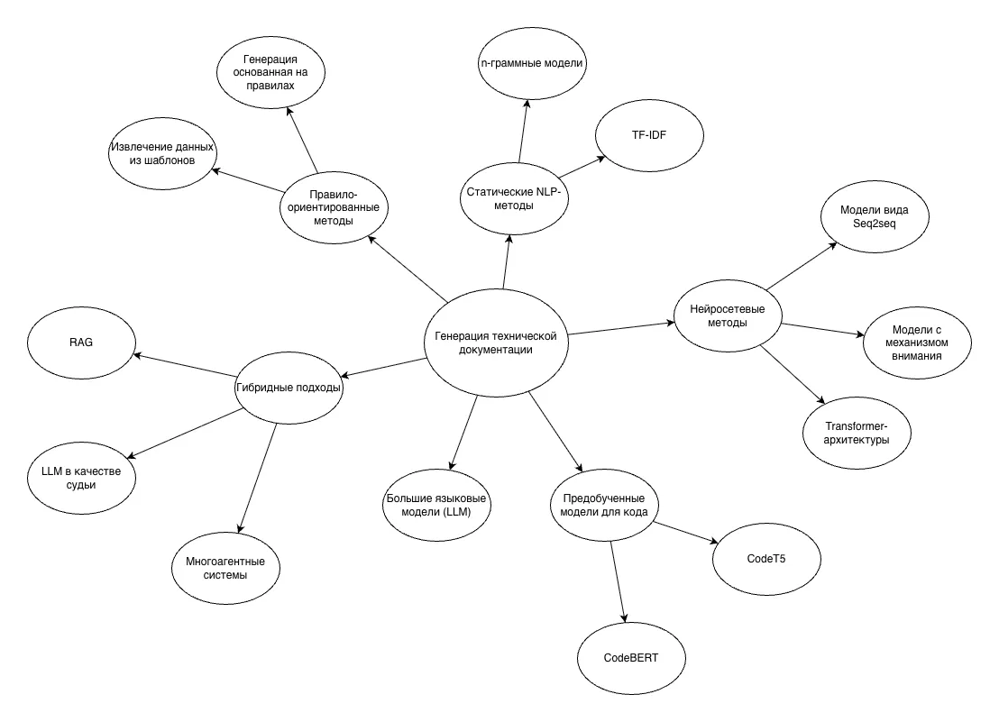

# Аналитический обзор по теме ВКР

## 1 ВВЕДЕНИЕ В ТЕМУ

### 1.1 Определение области исследования

В условиях роста сложности программных систем и комплексов особую значимость приобретает ведение, сопровождение и актуализация технической документации. Техническая документация является неотъемлемой частью жизненного цикла программных систем, обеспечивая передачу знаний между участниками разработки, удобство эксплуатации.

К технической документации относятся программные описания, документация программных интерфейсов (API), архитектурные спецификации, руководства пользователя, инструкции по эксплуатации и прочие документы.

Автоматическая генерация технической документации с использованием методов искусственного интеллекта представляет собой направление, сосредоточенное на снижении трудоемкости документирования за счет автоматического анализа артефактов разработки (исходный код, архитектурные модели, требования, тестовые сценарии и данные эксплуатации). В рамках данного направления применяются методы обработки естественного языка, машинного обучения и глубокого обучения для преобразования формальных или неструктурированных данных в связные, интерпретируемые и полезные текстовые описания.

В последние годы наибольшее развитие получили подходы, основанные на больших языковых моделях, обученных на масштабных объемах исходного кода и естественного языка. Такие модели способны выполнять задачи описания краткого содержания кода, генерации комментариев, автоматического создания файлов необходимых форматов и описаний изменений.

Генерация технической документации высокого уровня, требующей строгой семантической точности, структурированности и соответствия стандартам, остается сложной и не до конца решенной задачей.

### 1.2 Исторический контекст

На ранних этапах автоматизация документирования осуществлялась преимущественно с использованием правил-ориентированных и шаблонных подходов. Такие решения обеспечивают формальную корректность, но требуют строго структурированных входных данных и практически не учитывают семантику программ [21].

Работы с конца 2010-х годов смещаются в сторону нейронных моделей вида «sequence-to-sequence», применяемых для автоматического суммирования программных фрагментов. В частности, в исследованиях, посвященных нейросетевому суммированию подпрограмм, были предложены модели, преобразующие код в последовательность токенов с последующей генерацией текстового резюме на естественном языке [9].

Следующий этап связан с внедрением Transformer-архитектур и предварительно обученных моделей, таких как CodeBERT и CodeT5, которые позволили учитывать контекст, идентификаторы и семантические связи в программном коде. Параллельно развивались крупные языковые модели, обученные на масштабных наборах данных, включающих код и техническую документацию, что существенно расширило возможности генерации текстов [1].

C 2022 года наблюдается переход от изолированных моделей к комплексным системам, ориентированным на практическое применение. В исследованиях рассматриваются контекстно-осознанная генерация, архитектуры с применением нескольких моделей и использование подхода RAG (retrieval-augmented generation) для повышения достоверности результатов [5]. Больше внимания уделяется проблемам галлюцинаций, оценке качества и интеграции таких систем в реальные процессы разработки [6].

### 1.3 Актуальные вызовы

Несмотря на сравнимый прогресс, применение искусственного интеллекта для автоматической генерации технической документации сталкивается с рядом принципиальных ограничений.

Одной из наиболее острых проблем является склонность современных языковых моделей к генерации фактически некорректных или неполных описаний, что снижает доверие к автоматически сформированной документации и требует обязательной экспертной проверки [27].

Также сложность представляет оценка качества результатов. Распространенные автоматические метрики, такие как BLEU и ROUGE, не всегда адекватно отражают техническую точность и полезность документации, что затрудняет сравнение различных методов и воспроизводимость исследований [3].

Кроме того, большинство существующих работ ориентировано на узкий класс задач, связанных с генерацией комментариев или кратких описаний кода. Вопросы автоматического формирования архитектурной и эксплуатационной документации остаются недостаточно исследованными, несмотря на их высокую практическую значимость [34].

Существенным вызовом также является интеграция ИИ-систем в инженерные процессы с обеспечением прозрачности и наблюдаемости процесса, обновляемости и соответствия нормативным требованиям [37].

## 2 ТАКСОНОМИЯ ПОДХОДОВ

### 2.1 Классификация существующих методов

Многообразие исследований в области автоматической генерации технической документации обусловлено различиями как в типах генерируемых документов, так и в применяемых методах искусственного интеллекта. В обзорных работах подчеркивается, что отсутствие единой классификации затрудняет сопоставление результатов и воспроизводимость исследований, что делает систематизацию подходов необходимым этапом анализа предметной области [4]. Целесообразно классифицировать подходы по следующим критериям: тип входных данных, используемые модели и архитектуры, степень автоматизации, уровень учитываемого контекста.

По типу входных данных большинство подходов ориентировано на анализ исходного программного кода. В этом случае код рассматривается как последовательность токенов или абстрактное синтаксическое дерево, на основе которых формируется текстовое описание функций, классов или модулей [32]. Менее распространенными, но активно развивающимися являются подходы, использующие расширенный набор артефактов разработки: комментарии, историю изменений в системах контроля версий, архитектурные диаграммы и данные о выполнении программ [30].

С точки зрения используемых методов можно выделить следующие классы. Ранние исследования опирались на правила и шаблоны, а затем были дополнены статистическими NLP-подходами, использующими языковые модели и меры сходства текстов [22]. Существенный прогресс был достигнут с внедрением нейронных моделей вида «sequence-to-sequence», а затем Transformer-архитектур, способных учитывать более сложные синтаксические и семантические зависимости в коде [17].

Отдельный класс образуют большие языковые модели, обученные на масштабных количествах кода и технической документации. Их использование привело к развитию гибридных подходов, сочетающих нейронную генерацию с поиском информации и формальными правилами. Их применение позволило отказаться от заданных форматов входных данных и расширить спектр решаемых задач, включая генерацию комментариев, описаний изменений и пояснительных текстов различного уровня абстракции [19]. Это, в свою очередь, привело к развитию гибридных подходов, сочетающих нейронную генерацию с внешними источниками знаний, автоматической валидацией и многомодельными архитектурами [11].

По уровню учитываемого контекста подходы варьируются от моделей, генерирующих описание отдельной функции или метода, до систем, ориентированных на анализ архитектуры проекта и межмодульных связей. Последние рассматриваются как перспективное направление, поскольку они приближают автоматически генерируемую документацию к реальным потребностям сопровождения сложных программных систем [24].

### 2.2 Развитие методов

Хронология развития методов автоматической генерации технической документации представлена в таблице.

Таблица 2 – Хронология развития методов автоматической генерации технической документации

| Период | Доминирующие методы | Ключевые работы |
| --- | --- | --- |
| 2010-2012 | Шаблонные и эвристические методы | Towards Automatically Generating Summary Comments for Java Methods (2010) [21] |
| 2012-2015 | Статистические NLP-методы (n-граммы, TF-IDF) | On the Naturalness of Software (2012) [22] |
| 2016 | Переход к нейронным моделям | Summarizing Source Code using a Neural Attention Model (2016) [13] |
| 2016-2017 | Классические NLP-подходы, анализ «естественности» кода | On the Naturalness of Buggy Code (2016) [20] |
| 2018-2019 | Нейросетевые seq2seq-модели (RNN, LSTM, attention) | Deep Code Comment Generation (2018) [14]; A Neural Model for Generating Natural Language Summaries of Program Subroutines (2019) [9] |
| 2020 | Transformer-архитектуры | A Transformer-based Approach for Source Code Summarization (2020) [17] |
| 2020-2021 | Предобученные модели для кода и текста | A Pre-Trained Model for Programming and Natural Languages (2020) [18]; CodeT5: Identifier-aware Unified Pre-trained Encoder-Decoder Models (2021) [1] |
| 2022 | Большие языковые модели, автоматизация документации | Automatic Code Documentation Generation Using GPT-3 (2022) [2]; Chain-of-Thought Prompting Elicits Reasoning in LLMs (2022) [28] |
| 2023 | Контекстно-осознанные и архитектурные подходы | Knowledge Graph Based Repository-Level Code Generation (2023) [24]; Document Automation Architectures and Technologies: A Survey (2023) [37]; Context-aware Code Summary Generation (2024) [12] |
| 2024 | Контроль качества, снижение галлюцинаций | Using Large Language Models to Document Code (2024) [3] |
| 2025 | Гибридные, RAG и многоагентные системы | DocAgent: A Multi-Agent System for Automated Code Documentation Generation (2025) [11] |

### 2.3 Сравнительная таблица

Сравнение основных принципов автоматической генерации технической документации представлена в таблице.

Таблица 3 – Сравнительная таблица основных принципов автоматической генерации технической документации

| Подход | Преимущества | Недостатки |
| --- | --- | --- |
| Правило-ориентированный | Предсказуемость, соответствие стандартам, низкие вычислительные требования | Низкая адаптивность, невозможность обработки сложного контекста |
| Статистические NLP | Простота реализации, масштабируемость, воспроизводимость | Ограниченный учет семантики, низкое качество для сложных описаний |
| Seq2Seq (RNN) | Автоматизация генерации, лучшее качество в сравнении со статическими моделями | Потеря долгосрочного контекста, высокая чувствительность к данным |
| Transformer | Эффективная обработка контекста, масштабируемость | Высокие требования к данным и вычислительным ресурсам |
| Предобученные модели для кода | Понимание синтаксиса и семантики кода, универсальность | Зависимость от качества обучающих данных, высокая стоимость обучения |
| LLM | Связность и читаемость текста, универсальность | Галлюцинации, отсутствие гарантий корректности, сложность оценки результата |
| RAG | Повышенная достоверность, актуальность информации | Зависимость от качества поискового индекса, сложность архитектуры |
| Многоагентные системы | Модульность, гибкость, масштабируемость, распределение ролей | Сложность координации, высокая вычислительная сложность |

### 2.4 Классификационная схема

Общая схема, классифицирующая все подходы, применяемые для генерации технической документации представлены на рисунке.

Рисунок 2 – Классификация методов, применяемых для автоматической генерации технической документации

## 3 КРИТИЧЕСКИЙ АНАЛИЗ

### 3.1 Противоречия в литературе

Анализ научных публикаций, посвященных автоматической генерации технической документации с применением искусственного интеллекта, выявляет ряд противоречий, касающихся как оценки эффективности предлагаемых подходов, так и их практической применимости [15].

Одним из наиболее заметных расхождений является различие между количественными показателями качества генерации и реальной полезностью получаемых документов.

Во многих работах утверждается, что современные нейросетевые модели, использующие Transformer-архитектуру, обеспечивают значительный прирост качества по сравнению с более ранними подходами, что подтверждается ростом значений метрик BLEU и ROUGE. Однако в исследованиях, ориентированных на практическую оценку, подчеркивается, что высокие значения этих метрик не всегда коррелируют с технической корректностью и полнотой документации [26]. Таким образом, возникает противоречие между формальными результатами экспериментов и субъективной оценкой специалистов, использующих документацию в реальных условиях.

Другим источником противоречий является вопрос универсальности больших языковых моделей. С одной стороны, они демонстрируют способность генерировать разнообразные типы документации без специализированной настройки. С другой стороны, ряд работ указывает на нестабильность и склонность таких моделей к галлюцинациям, особенно при описании сложных или редко встречающихся программных конструкций [27]. В результате одни авторы рассматривают большие языковые модели как основу будущих систем документирования, тогда как другие подчеркивают необходимость их строгого ограничения и комбинирования с формальными методами.

### 3.2 Выявление тенденций и «белых пятен»

Анализ литературы позволяет выделить устойчивые тенденции, характеризующие современное состояние области. Прежде всего, наблюдается смещение фокуса исследований от генерации отдельных комментариев и кратких аннотаций к созданию более комплексных и контекстно-зависимых описаний программных систем [31]. Это отражает рост требований к качеству документации и ее роли в инженерных процессах.

Другой заметной тенденцией является активное развитие гибридных подходов, сочетающих генеративные модели с механизмами поиска информации и внешними источниками знаний. Такие архитектуры рассматриваются как средство преодоления ограничений чисто генеративных моделей в задачах, требующих высокой фактической точности [16]. Одновременно усиливается интерес к методам оценки и контролю качества, включая автоматизированный анализ и сравнение альтернативных вариантов документации [33].

На фоне этих тенденций выявляются и «белые пятна». Большинство существующих работ ориентировано на программную документацию низкого уровня, тогда как архитектурная и эксплуатационная документация остается недостаточно исследованной областью. Кроме того, мало внимания уделяется многоязычной документации и адаптации генераторов под требования конкретных отраслей и стандартов.

Также ограниченное внимание уделяется вопросам прозрачности и наблюдаемости между кодом, требованиями и документацией [36].

### 3.3 Методологические ограничения

Существенным ограничением большинства исследований является зависимость от ограниченного набора экспериментальных данных. Используемые датасеты, как правило, формируются на основе публичных репозиториев и не всегда отражают специфику промышленной разработки, что неоднократно подчеркивается в работах, посвященных выбору и анализу наборов данных для суммирования исходного кода [29].

Дополнительной проблемой является отсутствие общепринятых методик экспериментальной оценки. Разные авторы используют различные метрики и сценарии тестирования, что затрудняет прямое сравнение результатов и воспроизводимость исследований. В ряде случаев отсутствует детальное описание экспериментальных настроек и процедур обучения моделей, что снижает научную надежность выводов [39].

Также следует отметить методологическое ограничение, связанное с фокусом на генерации текста без учета процессов обновления и сопровождения документации. Большинство моделей обучается в статическом режиме и не ориентировано на работу в условиях непрерывной интеграции и изменения программных систем [35].

### 3.4 Неисследованные аспекты

К числу недостаточно изученных аспектов относится проблема обеспечения наблюдаемости между исходными артефактами разработки и сгенерированной документацией. В существующих работах редко рассматривается возможность автоматического обновления документации при изменении кода или архитектуры системы, несмотря на высокую практическую значимость данной задачи [10].

Еще одним малоисследованным направлением является интеграция формальных требований и стандартов в процесс генерации. Хотя нормативные документы, такие как IEEE и ISO, задают требования к структуре и содержанию технических описаний, современные модели генерации текста не обладают встроенными механизмами их строгого соблюдения [37].

### 3.5 Применимость к тематике

Проведенный анализ показывает, что, несмотря на активное развитие области, существующие подходы не в полной мере удовлетворяют требованиям к автоматической генерации комплексной технической документации.

Наиболее перспективным представляется подход, ориентированный на разработку гибридной системы, сочетающей возможности больших языковых моделей с механизмами поиска, формальными правилами и средствами валидации. Такой подход позволяет снизить влияние выявленных ограничений и сосредоточиться на решении практически значимой задачи, например, генерации документации для определенного класса программных систем или этапа жизненного цикла.

Анализ литературы не только выявляет существующие проблемы и противоречия, но и формирует основу для постановки научной задачи ВКР, направленной на восполнение выявленных пробелов и развитие перспективных направлений исследований.

## 4 ОПИСАНИЕ АКТУАЛЬНОСТИ

### 4.1 Обоснование выбора темы ВКР

Современные программные системы характеризуются высокой сложностью и быстрыми темпами развития, что существенно повышает требования к качеству и полноте технической документации. Документация играет ключевую роль в обеспечении сопровождаемости и масштабируемости программных решений, однако на практике ее создание и актуализация остаются трудоемкими и часто игнорируемыми процессами. В условиях гибких методологий разработки и частых изменений требований ручное документирование становится неэффективным, что неоднократно отмечается в исследованиях, посвященных влиянию документации на эволюцию программных систем [38].

Дополнительным фактором актуальности является рост объемов программного кода и усложнение архитектуры современных программных систем, что приводит к увеличению разрыва между реализацией и ее документированным описанием. Исследования в области «естественности» программного кода показывают, что отсутствие качественной документации затрудняет понимание логики системы даже для опытных разработчиков, не участвовавших в ее первоначальной разработке [22]. В таких условиях автоматическая генерация документации рассматривается не только как средство повышения продуктивности, но и как инструмент снижения рисков, связанных с сопровождением и передачей знаний.

Применение методов искусственного интеллекта для автоматической генерации технической документации рассматривается как перспективное направление снижения трудозатрат разработчиков и повышения качества документации. Современные языковые модели способны генерировать связные и формально корректные тексты на основе артефактов разработки, таких как исходный код и история изменений, что подтверждается результатами оценки моделей, обученных на программном коде [23]. Вместе с тем существующие решения в основном ориентированы на генерацию комментариев и кратких аннотаций, тогда как более сложные виды технической документации остаются недостаточно исследованными.

Научная актуальность выбранной темы обусловлена наличием нерешенных проблем, связанных с достоверностью, оценкой качества и соответствием стандартам автоматически сгенерированной документации. Противоречия в литературе и отсутствие единых методик оценки указывают на необходимость дальнейших исследований в данной области, особенно в контексте управляемости и интерпретируемости результатов генерации [28].

С практической точки зрения актуальность темы определяется растущим интересом индустрии к интеграции ИИ-инструментов в процессы разработки и сопровождения программного обеспечения, что подтверждается появлением промышленных решений и отчетов о внедрении больших языковых моделей в инженерные рабочие процессы [25].

Отдельное значение проблема приобретает в контексте эволюции программных систем. Большая часть существующих решений ориентирована на статическую генерацию текстов и не учитывает изменения кода во времени. В то же время исследования, посвященные генерации описаний небольших изменений, вносимых в программный код, демонстрируют потенциал автоматического документирования как части непрерывного процесса разработки, что делает данное направление особенно актуальным для современных практик [30].

Кроме того, рост интереса к использованию больших языковых моделей в инженерных задачах сопровождается осознанием их ограничений и рисков. Работы, посвященные анализу галлюцинаций и фактической некорректности в генеративных моделях, подчеркивают необходимость разработки специализированных подходов и архитектур для задач технической документации, где ошибки могут приводить к серьезным последствиям [27]. Это усиливает научную значимость исследований, направленных на повышение надежности и контролируемости автоматической генерации документации.

Таким образом, тема применения искусственного интеллекта для автоматической генерации технической документации является актуальной и обоснованной для ВКР, в особенности при фокусировке на конкретном типе документации или этапе жизненного цикла программных систем. Такой подход позволяет совместить научную новизну с практической значимостью получаемых результатов.

## 5 ПЕРСПЕКТИВНЫЕ НАПРАВЛЕНИЯ

### 5.1 Тренды последних 2 лет

Анализ публикаций 2024 и 2025 года показывает, что развитие автоматической генерации технической документации с использованием искусственного интеллекта смещается от повышения формального качества текста к обеспечению его достоверности, управляемости и практической применимости. Одним из ключевых трендов является активное внедрение подходов RAG, предполагающих использование внешних источников знаний для поддержки процесса генерации, что отражено в обобщающих работах и обзорных исследованиях [8].

Другим значимым направлением является развитие контекстно-осознанных моделей, учитывающих не только локальный фрагмент кода, но и более широкий контекст проекта, включая структуру системы, историю изменений и зависимости между компонентами. Это особенно важно для генерации комплексной документации, выходящей за рамки комментариев к отдельным функциям, и связано с развитием архитектур, ориентированных на работу с программными репозиториями целиком [18].

Отдельное внимание в последних исследованиях уделяется проблеме галлюцинаций и контролю качества. Предлагаются методы автоматической оценки и фильтрации сгенерированных текстов, в том числе с использованием самих языковых моделей в роли оценщиков или вспомогательных инструментов валидации. Такой подход отражает переход к более контролируемому использованию генеративных моделей в инженерных задачах [28].

Наконец, наблюдается рост интереса к архитектурам, в которых различные модели или агенты выполняют специализированные роли, такие как анализ кода, извлечение контекста и генерация документации. Эти подходы рассматриваются как средство повышения гибкости и модульности систем документирования и как шаг к промышленно применимым решениям [11].

### 5.2 Рекомендации для будущих исследований

На основе выявленных тенденций можно сформулировать ряд рекомендаций для дальнейших исследований в области автоматической генерации технической документации.

Прежде всего, перспективным представляется развитие гибридных систем, сочетающих возможности больших языковых моделей с формальными методами анализа и механизмами поиска информации.

Важным направлением является разработка метрик и методик оценки, ориентированных на техническую корректность и практическую полезность документации, а не только на формальное сходство с эталонными текстами.

Отдельного внимания заслуживает интеграция требований отраслевых стандартов и корпоративных регламентов в процесс генерации документации. Исследования в этом направлении могут способствовать расширению области применения ИИ-систем, особенно в проектах с повышенными требованиями к качеству и формальной структуре документации.

## 6 ВЫВОДЫ

Проведенный аналитический обзор научных исследований, посвященных применению методов искусственного интеллекта для автоматической генерации технической документации, позволил систематизировать существующие подходы, выявить основные тенденции развития области и определить нерешенные проблемы, сохраняющие актуальность на текущем этапе развития.

Анализ показал, что за период с 2018 по 2025 год произошел значительный переход от правил-ориентированных и статистических методов к нейросетевым моделям и большим языковым моделям, способным генерировать связные и контекстно-зависимые тексты.

Вместе с тем установлено, что, несмотря на высокое качество формально генерируемых текстов, существующие решения в большинстве случаев ориентированы на узкие задачи, такие как генерация комментариев и кратких аннотаций к исходному коду. Генерация более сложных видов технической документации, включая архитектурные и эксплуатационные документы, остается недостаточно изученной. Это ограничивает практическую применимость предложенных подходов и формирует потребность в дальнейших исследованиях.

Критический анализ литературы выявил противоречия между количественными метриками оценки качества и реальной полезностью документации, а также проблемы, связанные с галлюцинациями, отсутствием единых стандартов оценки и ограниченной воспроизводимостью экспериментов. Эти факторы указывают на необходимость перехода от чисто генеративных моделей к более управляемым и интерпретируемым решениям.

С учетом выявленных тенденций и ограничений в рамках выпускной квалификационной работы целесообразно сосредоточиться на следующих направлениях.

Во-первых, предпочтительным является использование гибридных подходов, сочетающих возможности больших языковых моделей с механизмами поиска информации, формальными правилами и средствами валидации. Такой подход позволяет повысить достоверность генерируемой документации и снизить влияние выявленных недостатков нейросетевых моделей.

Во-вторых, рекомендуется ограничить предметную область исследования конкретным типом технической документации или этапом жизненного цикла программной системы. Четкая фокусировка позволяет глубже проработать выбранную задачу и получить воспроизводимые результаты, обладающие практической значимостью.

В-третьих, важным направлением является разработка или адаптация методов оценки качества, ориентированных на техническую корректность и полезность документации. Даже частичное решение этой задачи в рамках ВКР может внести вклад в развитие методологических основ данной области.

Таким образом, результаты проведенного обзора подтверждают актуальность выбранной темы и позволяют обоснованно сформулировать цели и задачи выпускной квалификационной работы.

## 7 СПИСОК ИСПОЛЬЗОВАННЫХ ИСТОЧНИКОВ

1. CodeT5: Identifier-aware Unified Pre-trained Encoder-Decoder Models for Code Understanding and Generation [Электронный ресурс]. – 2021. – URL: https://arxiv.org/abs/2109.00859 (дата обращения 25.11.2025).

2. Automatic Code Documentation Generation Using GPT-3 [Электронный ресурс]. – 2022. – URL: https://arxiv.org/abs/2209.02235 (дата обращения 25.11.2025).

3. Using Large Language Models to Document Code: A First Quantitative and Qualitative Assessment [Электронный ресурс]. – 2024. – URL: https://www.arxiv.org/abs/2408.14007 (дата обращения 25.11.2025).

4. A Survey of Automatic Source Code Summarization [Электронный ресурс]. – 2022. – URL: https://www.mdpi.com/2073-8994/14/3/471 (дата обращения 25.11.2025).

5. Retrieval Augmented Generation (RAG) for LLMs [Электронный ресурс]. – URL: https://www.promptingguide.ai/research/rag (дата обращения 25.11.2025).

6. Hallucinations in Code Change to Natural Language Generation: Prevalence and Evaluation of Detection Metrics [Электронный ресурс]. – URL: https://arxiv.org/abs/2508.08661v1 (дата обращения 26.11.2025).

7. LLM as a Judge: опыт оптимизации генератора описаний Pull Request [Электронный ресурс]. – 2025. – URL: https://habr.com/ru/companies/yandex/articles/907646/ (дата обращения 25.11.2025).

8. Retrieval-augmented generation [Электронный ресурс]. – URL: https://en.wikipedia.org/wiki/Retrieval-augmented_generation (дата обращения 26.11.2025).

9. A Neural Model for Generating Natural Language Summaries of Program Subroutines [Электронный ресурс]. – 2019 – URL: https://arxiv.org/abs/1902.01954 (дата обращения 26.11.2025).

10. AsmDocGen: Generating Functional Natural Language Descriptions for Assembly Code [Электронный ресурс]. – 2024 – URL: https://www.scitepress.org/Papers/2024/127614/127614.pdf (дата обращения 26.11.2025).

11. DocAgent: A Multi-Agent System for Automated Code Documentation Generation [Электронный ресурс]. – 2025 – URL: https://aclanthology.org/2025.acl-demo.44 (дата обращения 26.11.2025).

12. Context-aware Code Summary Generation [Электронный ресурс]. – 2024 – URL: https://arxiv.org/abs/2408.09006 (дата обращения 26.11.2025).

13. Summarizing Source Code using a Neural Attention Model [Электронный ресурс]. – 2016. – URL: https://aclanthology.org/P16-1195 (дата обращения: 12.12.2025).

14. Deep Code Comment Generation [Электронный ресурс]. – 2018. – URL: https://www.researchgate.net/publication/326504269 (дата обращения: 13.12.2025).

15. A Survey of Machine Learning for Big Code and Naturalness [Электронный ресурс]. – 2018. – URL: https://arxiv.org/abs/1709.06182 (дата обращения: 13.12.2025).

16. Retrieval-Augmented Generation for Knowledge-Intensive NLP Tasks [Электронный ресурс]. – 2020. – URL: https://arxiv.org/abs/2005.11401 (дата обращения: 13.12.2025).

17. A Transformer-based Approach for Source Code Summarization [Электронный ресурс]. – 2020. – URL: https://arxiv.org/abs/2005.00653 (дата обращения: 13.12.2025).

18. A Pre-Trained Model for Programming and Natural Languages [Электронный ресурс]. – 2020. – URL: https://arxiv.org/abs/2002.08155 (дата обращения: 13.12.2025).

19. Evaluating Large Language Models Trained on Code [Электронный ресурс]. – 2021. – URL: https://arxiv.org/abs/2107.03374 (дата обращения: 13.12.2025).

20. On the Naturalness of Buggy Code [Электронный ресурс]. – 2016. – URL: https://arxiv.org/abs/1506.01159 (дата обращения: 17.12.2025).

21. Towards Automatically Generating Summary Comments for Java Methods [Электронный ресурс]. – 2010. – URL: https://dl.acm.org/doi/abs/10.1145/1858996.1859006 (дата обращения: 17.12.2025).

22. On the Naturalness of Software [Электронный ресурс]. – 2012. – URL: https://www.researchgate.net/publication/254041552 (дата обращения: 18.12.2025).

23. Evaluating Large Language Models Trained on Code (Codex) [Электронный ресурс]. – 2021. – URL: https://arxiv.org/abs/2107.03374 (дата обращения: 18.12.2025).

24. Knowledge Graph Based Repository-Level Code Generation [Электронный ресурс]. – 2023. – URL: https://arxiv.org/abs/2505.14394v1 (дата обращения: 18.12.2025).

25. OpenAI. GPT-4 Technical Report [Электронный ресурс]. – 2023. – URL: https://arxiv.org/abs/2303.08774 (дата обращения: 18.12.2025).

26. On Faithfulness and Factuality in Abstractive Summarization [Электронный ресурс]. – 2020. – URL: https://arxiv.org/abs/2005.00661 (дата обращения: 17.12.2025).

27. Survey of Hallucination in Natural Language Generation [Электронный ресурс]. – 2023. – URL: https://arxiv.org/abs/2202.03629 (дата обращения: 18.12.2025).

28. Chain-of-Thought Prompting Elicits Reasoning in Large Language Models [Электронный ресурс]. – 2022. – URL: https://arxiv.org/abs/2201.11903 (дата обращения: 18.12.2025).

29. Recommendations for Datasets for Source Code Summarization [Электронный ресурс]. – 2019. – URL: https://arxiv.org/abs/1904.02660 (дата обращения: 23.12.2025).

30. Automatic Generation of Pull Request Descriptions [Электронный ресурс]. – 2020. – URL: https://arxiv.org/abs/1909.06987 (дата обращения: 23.12.2025).

31. A Neural Architecture for Generating Natural Language Descriptions from Source Code Changes [Электронный ресурс]. – 2018. – URL: https://www.researchgate.net/publication/316184919 (дата обращения: 23.12.2025).

32. Generating Sequences from Structured Representations of Code [Электронный ресурс]. – 2018. – URL: https://arxiv.org/abs/1808.01400 (дата обращения: 23.12.2025).

33. AST-MHSA: Code Summarization using Multi-Head Self-Attention [Электронный ресурс]. – 2018. – URL: https://arxiv.org/abs/2308.05646 (дата обращения: 23.12.2025).

34. Generating Software Architecture Description from Source Code using Reverse Engineering and Large Language Model [Электронный ресурс]. – 2021. – URL: https://arxiv.org/abs/2511.05165v1 (дата обращения: 23.12.2025).

35. Towards Automatically Generating Release Notes using Extractive Summarization Technique [Электронный ресурс]. – 2021. – URL: https://arxiv.org/abs/2204.05345 (дата обращения: 23.12.2025).

36. Natural Language-Programming Language Software Traceability Link Recovery Needs More than Textual Similarity [Электронный ресурс]. – 2019. – URL: https://arxiv.org/pdf/2509.0558 (дата обращения: 23.12.2025).

37. Document Automation Architectures and Technologies: A Survey [Электронный ресурс]. – 2023. – URL: https://arxiv.org/abs/2109.11603 (дата обращения: 24.12.2025).

38. LLMs: A Game-Changer for Software Engineers? [Электронный ресурс]. – 2024. – URL: https://www.researchgate.net/publication/385528915 (дата обращения: 24.12.2025).

39. A Syntactic Neural Model for General-Purpose Code Generation and Documentation [Электронный ресурс]. – 2018. – URL: https://arxiv.org/pdf/1704.01696 (дата обращения: 24.12.2025).
